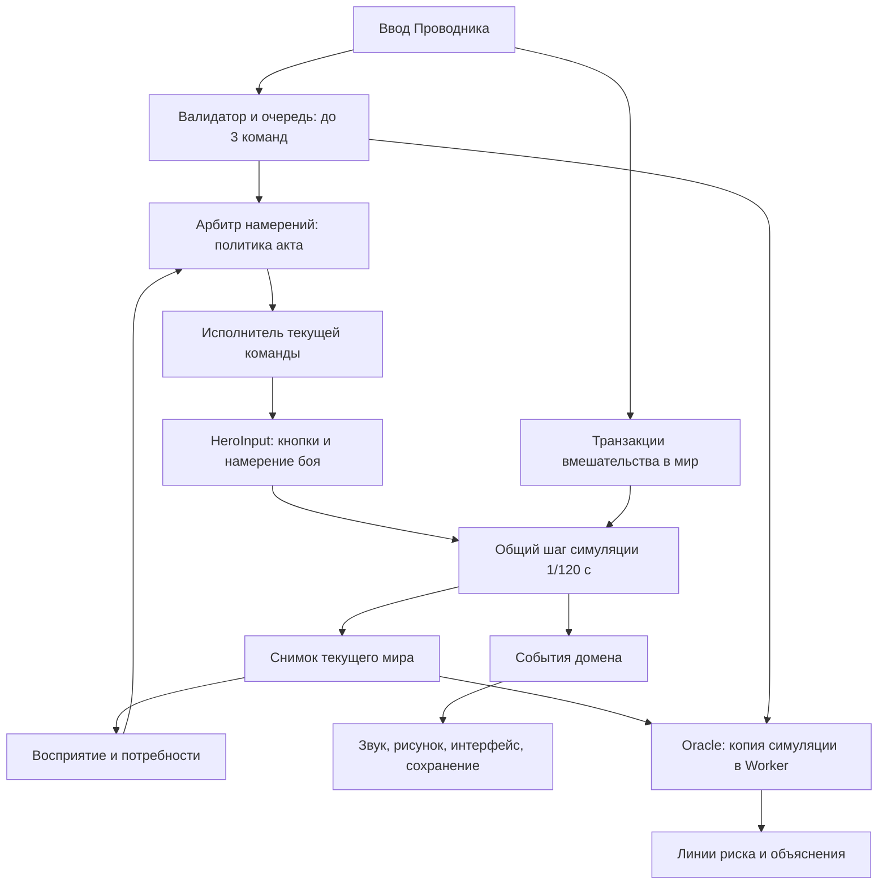
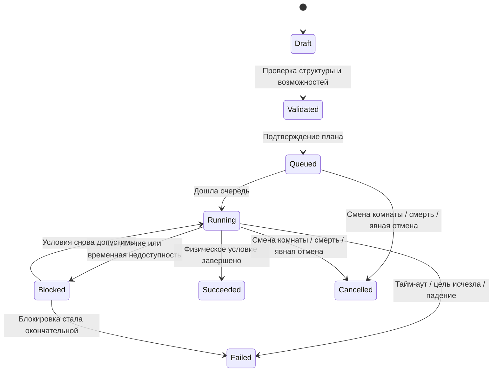

# Техническая архитектура ИИ героя и Проводника

Статус: архитектура полного GDD с реализацией слоя I акта. Исходная база изучена на коммите `d887b38` репозитория `gdrclm/Metroid`; состояние реализации, фактические имена модулей и проверки вынесены в [ACT-I-IMPLEMENTATION.ru.md](ACT-I-IMPLEMENTATION.ru.md). Прототип Hollow Tactics V4 прочитан и проверен девятью сценариями в Chromium. Описанные далее границы II–III актов остаются проектом.

Источники: [полный исходный GDD](reference/GUIDE-FEATURES.en.md), [оригинальный HTML-прототип](reference/hollow-tactics-v4.html), [аудит и полная матрица покрытия](HOLLOW-TACTICS-AUDIT.ru.md), [фактические результаты сценариев](reference/hollow-tactics-v4-audit.json).

Дополнение после получения **ACT-I-GDD / Production Backlog v1.0**: актуальный [производственный план](ACT-I-PRODUCTION-BACKLOG.ru.md) задаёт 66 комнат, безопасную автономию уже в I акте и четыре независимых параметра `Trust`, `SelfEfficacy`, `Dependency`, `Stress`. Сейчас существуют 43 комнаты. Старое требование «герой всегда ждёт без приказа» больше не является целевой архитектурой: это ограничение текущей реализации. Отсутствие сопротивления приказам сохраняется. Описанные ниже прежние границы модулей необходимо развить по новой матрице, а не считать завершённым HeroBrain.

## 1. Границы и неизменяемые решения

- Исходный GDD остаётся полным ТЗ. Полученный HTML-прототип — дополнительный источник готового кода; отсутствие механики в нём не исключает её из работ.
- Все существующие 22 комнаты, включая Вокзал, Кварталы и бой со смотрителем, относятся к I акту.
- В текущем срезе действует только политика I акта: герой исполняет команды Проводника без сопротивления. II–III акты сохраняются в общей архитектуре и плане реализации, но не включаются переходом между районами I акта.
- Сначала подготавливается архитектура, затем реализация. Проверенные механики HTML отмечены в отдельном аудите; он не заменяет полное ТЗ.
- ИИ работает локально и детерминированно. Для принятия игровых решений не требуются LLM, сервер или внешние API.

## 2. Исходные точки интеграции (база `d887b38`)

| Узел | Текущее поведение | Использование в новой архитектуре |
|---|---|---|
| `src/main.js`: `frame`, `handleMenus`, `setMode` | Фиксированный шаг, обработка ввода, режимы экрана | Добавить тактический режим и маршрутизацию команд |
| `src/game.js`: `update` | Оркестрация физики, боя, переходов, событий | Оставить единственным владельцем изменения мира |
| `src/physics.js`: `updatePlayer`, `moveBody`, `attackBox` | Контроллер 120 Гц, коллизии, окна движения | Общая основа исполнения и прогноза |
| `src/enemies.js`: `updateEnemy` | Телеграфы, атаки, снаряды, контактный урон | Источник реального поведения противников в прогнозе |
| `src/editor.js`: `draw` | Пробный расчёт траектории настоящим контроллером | Переиспользовать принцип симуляции, не интерфейс редактора |
| `src/save.js`: `newProgress`, `decodeSave` | Версия, миграция, checksum, резервная запись | Аддитивное сохранение нужд, связи, ресурсов и памяти |
| `src/game.js`: `interact`, `currentSurfaces` | Действия с объектами и сборка коллайдеров | Подключить убежища, временные конструкции и предметы |

В основном коде и в переданном HTML нет законченных систем щита, наземного переката, потребностей, фокуса Проводника и прицеливания по конечностям. В HTML подтверждены `move`, `jump` с дополнительным воздушным зарядом, `dash`, `attack`, редактирование очереди и черновой прогноз. Существующий рывок нельзя выдать за наземный перекат. Указанные отсутствующие системы остаются в объёме реализации.

## 3. Поток управления



ИИ не изменяет `player.x`, здоровье, инвентарь или флаги напрямую. Он формирует намерение. Физика и боевая модель решают, что произошло; события обновляют остальные системы. Это исключает телепортации, двойное списание ресурсов и разные правила для прогноза и настоящего героя.

### Проектируемые модули

| Модуль | Ответственность |
|---|---|
| `src/hero/director.js` | Сбор предложений и единственный выбор намерения на шаг |
| `src/hero/commands.js` | Валидация, очередь, FSM исполнения и результаты команд |
| `src/hero/perception.js` | Видимые угрозы, доступные объекты, память наблюдений |
| `src/hero/needs.js` | Нужды, дебаффы и производные характеристики тела |
| `src/hero/policies/act1.js` | Зависимость от Проводника, без права отменять его очередь |
| `src/simulation.js` | Снимок, общий шаг, события без внешних эффектов |
| `src/oracle-worker.js` | Прогноз, кандидаты путей, отмена устаревших расчётов |
| `src/guide/interventions.js` | Фокус, конструкции, доставка и приманка |
| `src/tactical-ui.js` | Ввод команд, точки прицеливания, отображение плана |
| `src/safehouse.js` | Действия предметов убежища и их транзакции |

Это предлагаемые границы модулей, а не утверждение, что перечисленные файлы уже реализованы.

## 4. Арбитраж и политика I акта

| Приоритет | Источник | Правило I акта |
|---|---|---|
| 0 | Смерть, загрузка, переход, тактическая/системная пауза | Не начинать новую управляемую активность |
| 1 | Физические ограничения: столкновение, оглушение, активная фаза действия | Соблюдать реальное состояние тела; сообщать блокировку |
| 2 | Активная команда Проводника | Продолжать исполнение; автономный ИИ не подменяет её |
| 3 | Следующая команда Проводника | Запускать ровно один раз после завершения предыдущей |
| 4 | Приманка Проводника при пустой очереди | Предложить ограниченное движение к проекции |
| 5 | Безопасное фоновое поведение | Цель нового ACT-I-GDD: идти по известной ровной опоре, остановиться у незнакомого края, восстановить равновесие; не выбирать далёкое направление. Текущий код в основном ждёт |

Потребности и страх не являются скрытым правом ИИ отвергать приказ. Они изменяют возможности тела и прогноз. Если истощение сорвало прыжок, результат — физическая неудача с объяснением, а не «герой решил иначе». Заведомо опасный, но физически допустимый приказ остаётся исполняемым: красная линия предупреждает игрока, а не отменяет выбор.

По новому ACT-I-GDD ограниченная реакция на непосредственную угрозу должна работать уже в I акте. Её следует оформить как явный результат арбитража с объяснением и возможностью перепланирования, а не скрытое неповиновение. Дальние цели исследования и самостоятельная победа над боссом в начале запрещены. Базовые столкновения и обработка полученного удара остаются физикой.

`story.act` задаёт сюжет. `volition` описывает отношения, но не переключает акт автоматически. Завершение башни R08, получение зацепа или посещение Кварталов не активирует неповиновение.

## 5. Команды и исполнитель

### Контракт команды

```json
{
  "id": "cmd-104",
  "type": "move",
  "target": {"x": 640, "feetY": 620},
  "roomId": "P05",
  "roomGeneration": 12,
  "timeoutTicks": 360,
  "issuedAtTick": 18420
}
```

`roomGeneration` меняется при каждой загрузке комнаты: старый приказ не должен попасть в нового противника с тем же ID после смерти или перезагрузки.

| Тип | Параметры | Условие завершения |
|---|---|---|
| `move` | Точка/смещение в мировых пикселях, допустимый тип движения | Достигнута область цели либо зафиксирована причина блокировки |
| `jump` | Направление, удержание, `completion: apex/landing`, необязательная цель посадки | Для воздушной цепочки команда отдаёт управление на апексе; для завершённого перехода — после реальной посадки |
| `dash` | Явно зафиксированное направление, проверка способности/заряда | Закончилась фаза реального рывка; не подменяет перекат |
| `guard` | Направление, длительность активной защиты | Истёк срок защиты; требуется реальный щит и боевая модель |
| `roll` | Направление | Закончилась физическая фаза переката с его собственными коллизиями и стоимостью |
| `attack` | ID + поколение врага, конечность | Один запуск атаки и завершение её восстановления |
| `interact` | ID объекта | Подтверждён результат реального доступного взаимодействия |
| `wait` | Число тиков | Истёк заданный срок симуляции |

В очереди максимум три команды, включая выполняемую. Черновик не исполняется до подтверждения. Быстрые клавиши также создают команды, а не обходят арбитр.



Поведение двойного прыжка сохраняется как самостоятельная способность с зарядом, восстанавливаемым при посадке. Его перенос в основной контроллер не должен бесплатно открывать ранние разрывы и шахты: доступность задаётся `ability.air_jump`, а размещение награды проверяется относительно шлюзов рывка P04/P05 и зацепа R04. Точная точка выдачи — задача интеграции уровня, а не побочный эффект копирования HTML.

Важно: правило «всякий прыжок завершается только после посадки» не подходит для очереди воздушных прыжков. По умолчанию цепочка передаёт управление на апексе; приземление остаётся проверяемым физическим результатом маршрута. Нельзя мгновенно выдать оба импульса в соседних тиках. Недоступный воздушный прыжок возвращает объяснимый результат вместо молчаливого пропуска.

Отмена активной команды атомарна: вместе с ней завершается принадлежащее ей намерение движения/боевой фазы. Позднее окончание отменённого рывка не имеет права вызвать `advanceCommand` для уже другой команды. Для этого исполнитель сверяет `commandId` и токен запуска фазы. Инерция и гравитация после отмены обрабатываются физикой.

Нужны коды результатов: `target_gone`, `unreachable`, `no_stamina`, `capability_missing`, `interrupted`, `timeout`, `room_changed`, `hazard`. Исполнитель не стирает неудачу и не заменяет маршрут молча. После неудачи зависимая часть очереди приостанавливается для перепланирования.

`pressed` для прыжка/атаки отправляется один раз при входе в соответствующую фазу. `down` удерживается столько, сколько требует активная команда. Списание выносливости, удар, подбор предмета и расход фокуса защищены ID действия от повторного применения.

### Прицеливание по конечностям

Конечности имеют локальные области, привязанные к реальному телу врага. Клик выбирает цель; урон возникает только в активной фазе атаки при пересечении `attackBox`, конечности и проверке видимости. Выбор колена не добавляет дистанцию оружию. Накопленный урон ноге может выдать событие `limb_disabled` и состояние `kneeling` по настройкам конкретного врага.

Сохраняется исправленный контракт смотрителя: выпад повреждает героя только при контакте тел, волна — при контакте со снарядом. Oracle использует те же проверки.

## 6. Тактическая пауза и Oracle

`Space` и выделенный триггер открывают `game.mode = tactical`; `Esc/Start` остаются отдельной системной паузой. Конфликт с нынешним `Space = jump` разрешается в таблице ввода, без двух действий от одного нажатия.

В тактическом режиме не вызывается шаг мира: останавливаются физика, противники, снаряды, потребности, TTL построек и прогресс активной команды. Планирование и явные транзакции Проводника доступны. Визуальное обесцвечивание отражает режим, а не заменяет остановку симуляции. Состояния частиц мира тоже не продвигаются; декоративная анимация UI может использовать отдельные часы. После возврата не накапливается пропущенное реальное время; `accumulator` очищается, удерживаемый ввод сбрасывается.

### Общая симуляция

Текущий `Game.update` включает звук, сохранение и изменение флагов. Его нельзя напрямую многократно вызывать для предсказания в живом мире. Выделяется чистый шаг:

```text
simulateStep(snapshot, heroInput, dt) -> { nextSnapshot, domainEvents }
```

Игровой путь применяет события к хранилищу, звуку и интерфейсу. Oracle работает с копией и не применяет внешние эффекты. Переиспользуются настоящие `updatePlayer`, геометрия ударов и логика противников; адаптер для последней собирает результаты вместо вызова живых `hurt`, `record` и `save`.

Снимок содержит: текущую комнату и её поколение, время симуляции, тело героя, здоровье, нужды, способности, фазу боевых действий, поверхности и механизмы, состояния врагов/снарядов, временные конструкции с TTL, версии очереди и мира, состояние детерминированного генератора решений.

Worker получает `{jobId, worldRevision, queueRevision, snapshot, commands}`. Возвращает полилинии, состояние посадки, ожидаемый урон, риск и коды причин. Результат применяется только при совпадении всех версий. Размещение платформы, изменение очереди или комнаты отменяет прежний расчёт.

| Цвет | Значение |
|---|---|
| Зелёный | Рассчитанный путь не пересекает подтверждённую опасность и имеет допустимую посадку/ресурсы |
| Жёлтый | Малый запас, неопределённая реакция врага, истекающая конструкция или незавершённая посадка за горизонтом |
| Красный | Подтверждённое пересечение опасности/активной атаки; летальность отмечается отдельным полем |

Нельзя выдавать зелёный цвет на основании одного расстояния до врага. Нужны его фаза атаки, LOS, реальная область попадания, здоровье героя, движущиеся опоры и остаточный срок конструкций. Термин «оптимальный» означает лучший среди проверенных кандидатов, а не обещание глобально идеального решения.

Предлагаемые бюджеты: горизонт до 6 секунд, максимум 720 физических шагов на вариант, ограниченный набор кандидатов, пересчёт по событию. Команды за пределами горизонта не объявляются безопасными. Прогноз обязан учитывать последствия `attack`: уничтоженное препятствие, погибшего врага и изменённый коллайдер, а не просто пропускать команду атаки. Частота и лимиты подлежат измерению в Chromium, а не объявляются гарантированной производительностью.

Преобразование указателя в мировую точку выполняется общей обратной матрицей вида: CSS-пиксели → пиксели canvas → обратный transform камеры. Простого `clientX - rect.left` из HTML недостаточно для камеры, масштабирования и мобильной ориентации. Используются Pointer Events; повтор `keydown` не переключает паузу многократно.

`tools/pilot.js` остаётся тестовым прохождением. Его знание конкретных комнат не становится скрытым всеведением героя.

## 7. Потребности, убежища и кофе

Состояние тела разделяется на независимые ресурсы:

- `needs.energy`: долгосрочная усталость; расход на нагрузку, восстановление сном.
- `combat.stamina`: краткосрочная выносливость для защиты, переката и действий.
- `needs.satiety`, `needs.stress`, `needs.corruption`: голод, напряжение и загрязнение.
- `guide.focus`: ресурс игрока-Проводника, а не здоровье/усталость героя.
- `link.volition`: отношение к управлению, отдельное от доступного сюжетного акта.

Из нужд вычисляются производные характеристики; базовый `physics.json` не мутирует. Голод при критическом значении уменьшает урон до 50% и снижает подвижность; коэффициенты и пороги задаются конфигурацией. Микросон — воспроизводимое состояние со сроком в тиках; его влияние видно в прогнозе. Ложная платформа является визуальным эффектом с отдельным признаком, а не настоящим коллайдером.

Урон увеличивает стресс событием. Пребывание в авторских тёмных зонах повышает напряжение; порог паники создаёт состояние и однократный звуковой отклик, а не многократный крик каждый кадр. Без активного приказа паника может остановить слабое самостоятельное поведение, но не становится скрытой политикой неповиновения I акта. Загрязнение увеличивает скорость роста стресса и при высоком уровне запускает периодический урон. Все таймеры остановлены в тактической/системной паузе. Ничего не пересчитывается по времени закрытой вкладки.

Убежища привязываются к существующим `rest.pier`, `rest.station`, `rest.kitchen`. Кровать, кухня, умывальник и кофейное место имеют отдельные действия и результаты. UI управления открывается только при физическом доступе героя к безопасной зоне; клик по меню не лечит удалённого героя в бою.

Кофе — транзакция инвентаря с ограниченным числом порций. Предлагаемый контракт: в убежище бафф подготовлен для следующей опасной комнаты; в полевой доставке действует в текущей комнате после физического подбора. Выход завершает активный бафф. В I акте послушание уже равно 100%, поэтому кофе не продаёт фиктивный прирост послушания: его действующий эффект — восстановление/фиксация выносливости. Более поздние политики смогут использовать тот же флаг без нового формата предмета.

Предлагаемые численные скорости нужд и расходы фокуса должны настраиваться после проверки длительности I акта. Архитектурный контракт не зависит от конкретных балансных чисел.

## 8. Инструменты Проводника и транзакции мира

Вмешательство не является командой тела. Оно проходит отдельную проверку и атомарное применение:

```text
validate(tool, placement, inventory, focus) -> WorldDelta | rejection
commit(WorldDelta) -> deductOnce + worldRevision++ + domainEvents
```

| Инструмент | Контракт |
|---|---|
| Эфемерная платформа | Коллайдер с `expireTick = currentTick + 360`; живёт ровно 3 секунды мира, включая корректную остановку таймера в паузе |
| Баррикада | Реальная поверхность; блокирует движение и снаряды по общей физике, имеет прочность и явное правило удаления |
| Доставка еды/кофе | Предмет появляется в мире из инвентаря, эффект возникает только после физического подбора |
| Приманка | Проекция с TTL; предлагает цель слабому ИИ при пустой очереди, но не вытесняет активный приказ |

Проверяются границы комнаты, пересечение с телами и геометрией, доступность точки размещения и ресурсы. Невалидное размещение не списывает фокус. Постройки хранятся отдельно от исходного JSON мира и включаются через `currentSurfaces`.

Для доставки нужен учёт предмета по ID: `inventory -> escrow/drop -> picked`. Сохранение, повторное событие и перезагрузка не должны одновременно оставлять копию в инвентаре и на земле. Правило возврата неполученной доставки задаётся явно и применяется один раз.

## 9. Полный объём: II–III акты

Следующие механики сохраняются в ТЗ, но не активируются в существующих районах I акта.

| Подсистема | Общий контракт и будущая политика |
|---|---|
| II акт: эго и сопротивление | `ActPolicy.evaluate(intent, context)` может предложить отказ или замену; решение имеет объяснение и не является случайной потерей ввода |
| Принуждение | Явное действие Проводника; фокус списывается один раз по ID приказа, а не каждый кадр |
| Сопротивление курсору | В браузере применяется к игровому виртуальному курсору; ОС-курсор программно переместить нельзя |
| Сдвиг платформы | Транзакция геометрии, инвалидация Oracle, событие реального падения и реакция связи |
| Усиление монстра | Временный модификатор его контроллера; прогноз учитывает новый темп и телеграфы |
| Саботаж убежища | Состояние конкретного объекта; кровать/вода перестают восстанавливать нужды, изменения сохраняются |
| III акт: согласованность | Политика разрешает автоматические микрореакции, оставляя макрокоманды и вмешательства игроку |
| Искажение интерфейса | Маска доступных сведений на входе отображения/Oracle, а не случайно неверная физика |
| Охотники за курсором | Отдельные сущности с целью `GuidePointerPose`, контактом с ресурсом Проводника и возможностью физического перехвата героем |
| Выгорание | Ресурс Проводника обнулён, тактическая пауза недоступна, самостоятельная политика ведёт героя; обычное меню паузы остаётся отдельным |
| Забота героя в убежище | Автономная цепочка действий с тем же исполнителем и транзакцией восстановления ресурса Проводника |

Ни новый регион, ни высокий стресс, ни рост `volition` сами по себе не включают эти политики. Нужны явные сюжетные переходы. Фоновые угрозы также прекращают симуляцию при потере фокуса вкладки.

## 10. Сохранение и жизненный цикл

Добавляется версия подсистемы внутри существующего сохранения:

```text
progress.guide = {
  schemaVersion: 1, storyAct: 1,
  needs, focus, volition, inventory, buffs,
  knownPatterns, safehouseStates, deliveryLedger
}
```

`decodeSave` добавляет значения по умолчанию и проверяет диапазоны, не сбрасывая существующие флаги, способности, карту, настройки и места отдыха. Формат внешней оболочки и резервная запись сохраняются.

Очередь команд, текущие полилинии Oracle, ссылки на живые экземпляры врагов и размещённые временные коллайдеры не переживают смерть/загрузку комнаты как активные действия. Их адресаты требуют нового поколения комнаты. Состояния инвентаря и доставок согласуются до сохранения. Кофе не получает новую порцию и новый срок от повторного входа/загрузки.

## 11. Порядок реализации и приёмка

1. Выполненный аудит HTML использовать как карту повторного использования: [результаты](HOLLOW-TACTICS-AUDIT.ru.md). Зафиксировать поведение команд, переносить подтверждённые части через адаптеры к основному контроллеру, не импортировать второй игровой цикл.
2. Выделить общий шаг/снимок и поток событий. Проверить совпадение траекторий текущего контроллера с базовой версией.
3. Подключить валидатор, очередь из трёх команд, исполнитель и политику I акта; затем активную паузу.
4. Подключить нужды, реальные защиту/перекат, прицеливание по конечностям и соответствующие результаты исполнения.
5. Подключить Oracle, временные конструкции, доставку и приманку на общей геометрии.
6. Подключить убежища, кофе, миграцию сохранений и прохождение всего I акта.
7. Реализовывать будущие политики/инструменты II–III актов отдельными сценариями с явными сюжетными воротами; это не расширяет текущий срез до трёх актов.

Критерии проверяются поведением, а не наличием флага в UI:

- За время тактической паузы не меняются координаты, снаряды, нужды, TTL и прогресс команды; после возврата нет накопленного скачка симуляции.
- Три приказа выполняются по порядку, четвёртый не принимается; атака и списания происходят ровно один раз.
- I акт ни при каких нуждах/значении воли не подменяет валидный приказ автономным решением.
- Предсказанный путь совпадает с исполнением при одинаковом снимке; устаревший ответ Worker не рисуется.
- Щит/перекат имеют реальные окна и ограничения; выбор конечности не наносит дистанционный урон.
- Временная платформа существует 360 шагов мира, может служить опорой и действительно исчезает; баррикада реально останавливает снаряд.
- Доставка требует подбора, не размножается при сохранении/смерти; кофе не дублируется и не увеличивает срок от загрузки.
- Убежища требуют доступного объекта и корректно изменяют именно выбранные нужды.
- Ни одна из 22 комнат не переводит игру во II акт; весь I акт проходим без отладочной телепортации и неуязвимости.
- Сохранены регрессии контроллера, коллизий смотрителя, переходов, мобильного ввода и аудио.

## 12. Перенос подтверждённых частей прототипа

- `toggleTacticalPause` и живое добавление приказов дают готовый сценарий UX. Управление временем подключается к существующему `setMode`/фиксированному шагу.
- `commandQueue/currentCommand`, удаление по клику и отображение текущей команды адаптируются к командам с ID, лимиту три и FSM. Нельзя переносить безлимитную очередь и неатомарную отмену рывка.
- `executeCommandLogic` служит источником переходов для движения, прыжка и рывка. Запись `vx/vy` заменяется выдачей `HeroInput`; числа в пикселях/кадр не копируются в контроллер 120 Гц.
- Дополнительный прыжок и направление рывка сохраняются в контрактах способностей. Это сокращает проектирование поведения, но не отменяет проверки прогрессии основного мира.
- `drawPredictiveTrajectory` даёт клонирование тела/очереди и полилинию. Дублированная физика заменяется общим `simulateStep`; атаки, динамические враги, риски и изменения мира входят в прогноз.
- Слабое блуждание и `patrol/chase` дают исходные предложения поведения. Они подчиняются политике акта и управляемому генератору случайности; не пишут скорость героя после выбранного приказа.
- Разрушение плитки подтверждено как дополнительная механика прототипа. При переносе используется событие изменения геометрии с версией мира, а не изменение общего массива прямо из обработчика UI.

Полная матрица исходного GDD, включая отсутствующие системы и будущие акты, находится в аудите. Факт наличия работающей кнопки не означает готовности к переносу: нужны одинаковая физика, корректная отмена, сохранение и завершённый сценарий.
