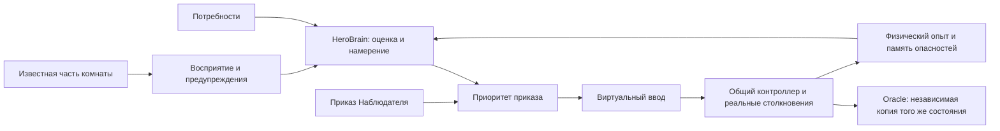

# HeroBrain — восприятие, намерения и ограниченная самостоятельность I акта

Реализованный игровой ИИ отделён от очереди приказов и физики. Он принимает решения по доступному наблюдению, потребностям и накопленному физическому опыту. Тестовые драйверы маршрутов остаются только в `tools/`; в игровой код они не импортируются.

## Модули и ответственность

| Файл | Ответственность |
|---|---|
| `src/hero/perception.js` | Ближний обзор, видимость врагов, наблюдаемые предметы и снаряды; отдельные предупреждения о слышимой атаке |
| `src/hero/navigation.js` | Проверка непрерывной опоры, стен, известных опасностей и переходов; короткий физический пробный прыжок |
| `src/hero/brain.js` | Намерение, восстановление, защитный рефлекс, отдых, наблюдение, осторожное исследование и обучение |
| `src/hero/brain-state.js` | Сохраняемый физический опыт, память опасностей, нормализация старых/повреждённых данных |
| `src/hero/director.js` | Порядок обновления, приоритеты, жизненный цикл и снимок для Oracle |
| `src/hero/commands.js` | Прямое исполнение приказов, результаты и быстрая очистка заблокированного движения |

## Приоритеты и состояния

Смерть, переход, пауза, оглушение и микросон ограничивают доступные действия. Активная команда игрока исполняется с приоритетом над самостоятельными намерениями. Герой не отклоняет рискованный приказ и не заменяет очередь собственной атакой.

Когда очередь свободна, он сначала заканчивает физическое действие и оценивает непосредственную угрозу. Затем проверяет равновесие, потребность в отдыхе, видимую приманку и возможность осторожного перемещения. После выполнения или отмены указания сохраняет выбранное игроком место; нужды и близкая угроза могут вызвать самостоятельную реакцию. После неудачного движения ждёт нового пути.

| Состояние | Поведение |
|---|---|
| Осматривается | Слушает, оценивает ближайшую дорогу, ждёт у неизвестного края |
| Осторожно идёт | Проходит короткий видимый участок с проверенной опорой |
| Изучает место | Подходит к замеченной детали, не начинает разговор и не расходует предметы сам |
| Ищет отдых | При усталости, голоде или стрессе направляется к видимому месту отдыха в той же комнате |
| Отходит от угрозы | Выбирает ближайший безопасный участок отступления |
| Прикрывается / уклоняется | Реагирует на видимую подготовку или летящий снаряд при свободной очереди |
| Преодолевает препятствие | Выполняет освоенный простой прыжок после физической проверки |
| Восстанавливает равновесие | Следит за падением и выдерживает короткую паузу после приземления |
| Ждёт нового пути | Сохраняет место после заблокированного приказа |
| Выполняет приказ | Подчиняется текущему действию игрока |

Текущее намерение и его причина показаны в пульте. Отладочная панель дополнительно показывает видимых врагов, число слышимых предупреждений и известные опоры, цель и физический опыт.

## Восприятие и безопасный путь

Обзор пересчитывается через 0,1 секунды игрового времени. Он ограничен камерой и радиусом 380 px. Для врагов и предметов проверяется линия видимости. Атака за преградой может дать звуковое предупреждение, но её координаты не превращаются в доступную боевую цель.

Путь по земле проверяется с шагом не более 8 px: свободное тело, опора под обеими сторонами и серединой ступней, известные опасности и расстояние до автоматического перехода. Движущиеся известные опоры используются в текущем положении; исчезнувшая конструкция перестаёт считаться опорой. Временная платформа с малым оставшимся сроком отвергается как ненадёжная.

На старте самостоятельное удаление от последнего места указания ограничено 240 px; освоенные действия расширяют локальную уверенность максимум до 560 px. Каждый следующий участок всё равно должен быть видимым и проверенным. Самостоятельный переход в другую комнату не выполняется. Память известного края увеличивает осторожную дистанцию; если герой видит, что пол восстановлен, прежняя отметка не блокирует путь.

## Физическое обучение и защита

Опыт прыжка засчитывается после настоящего безопасного приземления без потери здоровья, а не при отправке команды или достижении вершины дуги. После двух успешных приземлений герой может самостоятельно преодолеть небольшую преграду. Проверяется один вариант обычного прыжка настоящим `updatePlayer`: до 144 шагов, не чаще раза в 0,6 с. Неизвестное место приземления, опасность, враг или непредвиденный выход из комнаты отвергают вариант. Самостоятельные стеновые, воздушные и комбинированные маршруты здесь не добавлены.

Щит и перекат используют существующие ограничения тела, выносливости и уязвимости. Защитная реакция не включает автопобеду: герой сам не атакует Смотрителя, не получает дополнительную неуязвимость и не расходует общие припасы. Сложные боевые планы остаются задачей игрока.

Физический опыт сохраняется отдельно от воли и будущих `Trust`, `SelfEfficacy`, `Dependency`. Память ограничена 24 отметками; нормализация добавляет значения по умолчанию старым сохранениям и отбрасывает некорректные записи. Полная психологическая модель пока остаётся в backlog.

## Очистка движения перед препятствием

Для `MOVE` проверяется настоящий боковой упор в твёрдую геометрию или границу комнаты. Если герой стоит на опоре, не продвигается ни по X, ни по Y и имеет нулевую скорость, через **0,16 с игрового времени** приказ завершается с причиной: «Перед героем препятствие: действие очищено. Нужен новый путь».

Очищается также зависимый остаток плана, чтобы прыжок или удар не выполнились в незапланированной точке. Новый приказ можно поставить сразу. Снятие стены само по себе не возобновляет уже отменённое действие. Воздушное движение, торможение у цели и вертикальное перемещение на опоре не считаются неподвижным упором. Общий тайм-аут остаётся запасной защитой остальных неисполняемых действий.

## Проверки и дальнейший объём

В `tests/hero-brain.test.js` проверяются оба направления упора, настоящий P01 и освоение его ступени, обрыв, автоматический переход, опасное приземление, вертикальная платформа, приоритет приказа, видимый и скрытый противник, поиск отдыха, сохранение опыта, пауза и совпадение Oracle с реальной автономией. Прежние непрерывные маршруты всех 43 комнат сохранены.

`npm run test:hero-brain` проверяет настоящий первый экран без подмены геометрии: самостоятельную ходьбу, очистку приказа у ступени, обучение реальными командами и последующий самостоятельный прыжок. Отдельно проверяются подход уставшего героя к убежищу с подготовленной позиции и видимость статуса на трёх touch-размерах. Скриншоты и JSON — в `artifacts/`.

Следующие задачи: полноценный граф опор комнаты, многоярусная навигация, маршруты через движущиеся платформы, расширенная тактическая память, связь физического опыта с четырьмя параметрами отношений и отладочный график обучения. Ограниченное знание самого Oracle и остальные требования полного I акта учитываются в [производственном плане](ACT-I-PRODUCTION-BACKLOG.ru.md).
